# AdaptOrch MCP

<p align="center">
  <a href="https://adaptorch.com">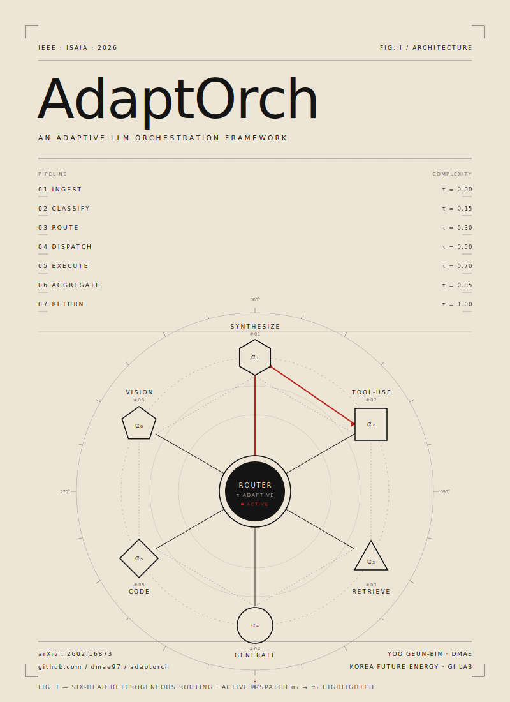</a>
</p>

<p align="center">
  <a href="https://adaptorch.com"><strong>adaptorch.com</strong></a>
  ·
  <a href="https://adaptorch.com/#proof"><strong>Live Three.js OFF vs ON Demo</strong></a>
  ·
  <a href="https://adaptorch.com/#onoff-bench"><strong>Benchmarks</strong></a>
  ·
  <a href="docs/adaptorchctl-usage.ko.md">adaptorchctl 한국어 가이드</a>
  ·
  <a href="docs/configuration.md">Configuration</a>
  ·
  <a href="docs/tools.md">Tools</a>
  ·
  <a href="docs/claude-code-b2c.md">Claude Code guide</a>
  ·
  <a href="docs/github-action.md">GitHub Action</a>
  ·
  <a href="https://github.com/marketplace/actions/adaptorch-run-and-evidence">GitHub Marketplace</a>
  ·
  <a href="docs/remote-service-distribution.md">Remote service boundary</a>
  ·
  <a href="docs/publishing.md">Publishing</a>
  ·
  <a href="https://arxiv.org/abs/2602.16873">Paper</a>
</p>

<p align="center">
  <a href="https://pypi.org/project/adaptorch-mcp/"></a>
  
  
  
  <a href="https://adaptorch.com"></a>
  <a href="https://arxiv.org/abs/2602.16873"></a>
  <a href="https://glama.ai/mcp/servers/dmae97/Adaptorch-MCP"></a>
  <a href="https://glama.ai/mcp/connectors/io.github.dmae97/adaptorch-mcp"></a>
</p>

**AdaptOrch MCP** (`adaptorch-mcp` 0.6.3) is the remote-only Model Context Protocol (MCP) server for [AdaptOrch](https://adaptorch.com) — bringing **DAG topology routing**, **multi-model LLM output synthesis**, **bounded generation observations (`run-generation.v1`)**, and **verifiable execution receipts** directly into Claude Code, Cursor, Codex, Gemini CLI, Windsurf, Kimi Code, and Grok. The private engine owns routing and execution on the server; it is not installed by this package. Trace access requires the explicit `full` profile; this adapter does not expose the research-only inference-tape replay API.

Use it when your coding agent says a patch works and you want the receipt before you merge, or when a task is too large, too ambiguous, or too expensive to trust to one single-pass response. The [AI-generated patch verification guide](https://adaptorch.com/ai-generated-patch-verification/) shows how to use evidence when reviewing a proposed change.

```text
Claude Code → AdaptOrch MCP → route topology → run with synthesis → retrieve artifacts
```

## Get your API key

AdaptOrch requires authentication. Get your token in two steps:

1. **Sign up** → [adaptorch.com/app/signup](https://adaptorch.com/app/signup)
2. **Create an API key** → [adaptorch.com/app/api-keys](https://adaptorch.com/app/api-keys) → generate a key (starts with `ado_`)

Use that key as `ADAPTORCH_CONTROL_PLANE_TOKEN`:

```bash
export ADAPTORCH_CONTROL_PLANE_TOKEN="ado_..."
export ADAPTORCH_API_KEY="$ADAPTORCH_CONTROL_PLANE_TOKEN"
```

Model-backed hosted runs require BYOK. Keep provider credentials in your local environment:

```bash
export ADAPTORCH_MCP_PROVIDER="openai"
export ADAPTORCH_MCP_PROVIDER_MODEL="gpt-4.1-mini"
export ADAPTORCH_MCP_PROVIDER_API_KEY="<provider-api-key>"
```

These values are not MCP tool arguments or JSON body fields. The local wrapper attaches them only to run submission headers and redacts the provider key from errors. Direct HTTP clients may attach configured headers to other requests as well; check your client's secret-handling settings.

**OAuth BYOK (current source):** `openai_codex` accepts a caller-owned OAuth access
 token in the same key slot, with `ADAPTORCH_MCP_PROVIDER_AUTH_TYPE=oauth` and
`ADAPTORCH_MCP_PROVIDER_ACCOUNT_ID=<your-account-id>`. A long-lived local MCP can
use `ADAPTORCH_MCP_PROVIDER_API_KEY_COMMAND=<trusted-token-helper>` instead of a
static key. The helper is caller-provided and must print only the fresh access
token; login/refresh stays on the client. Never send refresh tokens, cookies or
an entire auth file. Both the control plane and local engine must support this
source contract. RQ dispatch still refuses request-scoped credentials.

### Signup → MCP → dashboard run list

1. Sign up at `/app/signup` and open `/app/api-keys`.
2. Generate an `ado_*` key and copy the raw value once.
3. Set it only in your local MCP environment as `ADAPTORCH_CONTROL_PLANE_TOKEN`.
4. Run `adaptorch_run` or `adaptorch_list_runs` from Claude Code.
5. Refresh `/app/runs` in the dashboard to see the same tenant's run list.

한국어 요약: 가입 → `/app/api-keys`에서 `ado_*` 생성 → MCP env에 설정 → Claude Code에서 실행/목록 확인 → 대시보드 `/app/runs`에서 같은 실행 목록 확인.

| Token | Purpose | Where to get it |
| --- | --- | --- |
| `ADAPTORCH_CONTROL_PLANE_TOKEN` | All AdaptOrch API calls (run, status, artifacts) | Dashboard after signup |
| `ADAPTORCH_MCP_HTTP_AUTH_TOKEN` | Protect your local HTTP MCP endpoint | You define it (any secure string) |

Plan prices and monthly run quotas come from [the hosted plan catalog](https://adaptorch.com/v1/plans), not the installed package. BYOK provider charges are separate from the AdaptOrch subscription; an AdaptOrch key is not a provider key.

### Engine-delegated optional algorithm controls (latest)

AdaptOrch MCP forwards optional algorithm controls to the hosted `adaptorch`
engine. The public client does not implement these algorithms. Treat these as
benchmark/eval or operator controls, not quickstart defaults.

| Control | Scope | Verified behavior |
| --- | --- | --- |
| `ADAPTORCH_REPRODUCIBLE` | Benchmark/eval beta | Fixes benchmark clock/RNG sources and canonicalizes record timing/path fields. It does not cover live-provider outputs, parallel-suite record order, cassettes, traces, or report timing aggregates. |
| `manifest_canonical_sha256` | Benchmark manifest | Importable as `adaptorch.benchmarking.manifest_canonical_sha256`; hashes canonical nonvolatile manifest fields. |
| `ADAPTORCH_ROUTER_ACCURACY_GATE` | Online router | `point` is the default; `wilson` uses a Wilson lower bound for learned-model adoption. Pair with operator knobs such as `retrain_window`, `min_loo_accuracy`, `min_posterior`, `quality_floor`, `use_quality_weights`, `use_failure_evidence`, `exploration_rate`, `max_observations`, `cv`, and `kfold_k`. |
| `pass_rate_credit` / `quality_signal` | Online-router learning | `compute_quality` tries exact-answer token matching before fuzzy matching. `pass_rate_credit` is opt-in partial credit; do not claim it changes `AdaptOrchEngine` router feedback by default. |
| `ADAPTORCH_PAPER_SEMANTIC_WEIGHT` | Synthesis | Default is `0.35`. Nonzero semantic weight, plus CJK/Hangul inputs, use Python scoring rather than the native fast path. |
| `prefer_multi_model_ensemble_singleton` | Routing threshold | Tri-state: unset auto-enables when at least two ensemble providers exist and synthesis mode is not `direct`, unless an explicit debate-singleton preference wins; explicit `false` disables the auto preference. The MCP hint `prefer_ensemble_singleton` accepts `true`/`false`/`null` with the same semantics. |
| `synthesis_mode` | Synthesis | Supported modes are `paper`, `robust`, `robust_lite`, and `stable_hybrid`. `fourier_aggressive` aliases `stable_hybrid`. Serving-only `auto` asks the control plane to choose; it is not an additional engine algorithm. |
| `output_extractor` | Ensemble extraction | Engine extractors are `final_answer` and `multiple_choice_letter`. The MCP value `none` means "no extractor" and is not forwarded. |
| `verification_status` | Evidence report | `GET /v1/runs/{run_id}/evidence` adds `execution_status`, `verification_status` (`NOT_RUN`, `PASSED`, `FAILED`, `INCONCLUSIVE`) and `verification_source` (`vera_v2`, `verification_items`, `none`). Only an all-`PASSED` set of verifier checks is `PASSED`; a lone run-level check reports execution, so its verdict stays `NOT_RUN`. `adaptorch-client` 0.1.5 types all three; older servers leave them `None`. |
| `is_training_eligible` | Online-router learning | Only `verification` and `gold_label` outcome sources train the naive-Bayes router or update the LinUCB bandit; self-consistency and unrecorded sources are stored but never rewarded. Bandit state is saved as version 2, and a version 1 file replays only its eligible observations. |
| `ADAPTORCH_EVIDENCE_BASIS_ENABLED` | Control-plane switch | Off by default. When a control plane enables it, `GET /v2/runs/{run_id}/evidence` adds a per-check `basis`. This wrapper's remote profile does not expose the engine's `include_evidence_basis` argument. |

## Research paper

AdaptOrch MCP follows the AdaptOrch research line. The [official AdaptOrch research page](https://adaptorch.com/research/) summarizes the paper and explains how it relates to the hosted service. Read the paper on arXiv:

- Abstract page: [arxiv.org/abs/2602.16873](https://arxiv.org/abs/2602.16873)
- HTML paper: [arxiv.org/html/2602.16873v1](https://arxiv.org/html/2602.16873v1)

<p align="center">
  <a href="https://arxiv.org/html/2602.16873v1">
    
  </a>
</p>

<p align="center"><sub>Figure preview is sourced from the arXiv HTML version.</sub></p>

## Install

The [official client reference](https://adaptorch.com/clients/) lists the public MCP, CLI and Python SDK clients. There are four ways in. Pick by what you are: a Claude Code user, an agent, a program, or a
terminal.

> **Release status (2026-11-03):** `adaptorch-mcp` 0.6.1, `adaptorch-cli` 0.1.6 and
> `adaptorch-client` 0.1.6 are published. `adaptorch-mcp` 0.6.x is a remote client with
> no engine dependency. It forwards MCP calls to `POST /v1/mcp`; adaptorch.com serves that
> path since 2026-11-03 (before that, every 0.6.0 call failed with "Remote MCP request failed").
> `adaptorch-mcp` 0.3.0–0.5.2 depend on the engine distribution and do not install
> against the code-free `adaptorch` 0.2.0; use 0.6.0 or later.

**Source update (2026-10-26, not a publication):** the workspace engine pin moves to
`a490658c`, the revision the engine's runbook last recorded as served by the hosted
control plane. `adaptorch-client` and
`adaptorch-cli` 0.1.5 reuse keep-alive connections for reads (TLS 1.2 minimum, one
CA-store load per client), type the evidence verification verdict, and parse large
responses about twice as fast. The local MCP connector shares the same transport, its
HTTP listener is bounded, and `adaptorchctl run wait` now honours `--timeout`. See
[network and transport notes](#network-and-transport-notes).

**Source update (2026-09-08, not a publication):** this checkout adds request-scoped
SDK BYOK, bounded read-only polling, subject-bound responses and typed algorithm
observations. The local MCP facade uses a one-attempt, redirect-free transport and
preserves requested/selected modes without exposing private diagnostics. See the
[client contract and verification record](docs/2026-09-08-algorithm-client-contract.md).

### Claude Code plugin

The plugin adds the AdaptOrch MCP tools and a skill that tells Claude when and how to use
them. It needs [`uv`](https://docs.astral.sh/uv/) on your `PATH`.

```bash
claude plugin marketplace add dmae97/Adaptorch-MCP
claude plugin install adaptorch@adaptorch
```

Configure the AdaptOrch service key using `/plugin configure adaptorch@adaptorch`. For
model-backed runs, also configure a provider, model ID and provider key in the dialog.
Sensitive fields are stored in Claude Code's credential store. The plugin runs the
published `adaptorch-mcp` 0.6.x remote client over stdio. Details are in
[plugins/adaptorch](plugins/adaptorch/).

### Kimi Code, Grok Build and Grok Bot

This repository also ships a Kimi Code plugin and a Grok Build plugin with the same public
MCP client and an AdaptOrch skill. The Cursor plugin is the starting point for Grok Bot
marketplace review. Setup, authentication and the separate listing status are documented
in [agent platform integrations](docs/agent-platform-integrations.md). These are
AdaptOrch-maintained integrations; hosting a marketplace in this repository does not
imply listing in or endorsement by an upstream marketplace.

### 1. Hosted MCP — nothing to install (recommended)

The control plane serves MCP over HTTP at `https://adaptorch.com/mcp`. Any client
that speaks HTTP MCP connects directly with your `ado_*` key:

```bash
: "${ADAPTORCH_API_KEY:?Set your AdaptOrch API key}"
: "${ADAPTORCH_MCP_PROVIDER:?Set your provider}"
: "${ADAPTORCH_MCP_PROVIDER_MODEL:?Set your model}"
: "${ADAPTORCH_MCP_PROVIDER_API_KEY:?Set your provider key}"
claude mcp add --transport http adaptorch https://adaptorch.com/mcp \
  --header "Authorization: Bearer ${ADAPTORCH_API_KEY}" \
  --header "X-Provider: ${ADAPTORCH_MCP_PROVIDER}" \
  --header "X-Provider-Model: ${ADAPTORCH_MCP_PROVIDER_MODEL}" \
  --header "X-Provider-Key: ${ADAPTORCH_MCP_PROVIDER_API_KEY}"
```

Set all four environment variables above before configuring model-backed runs.
The CLI uses `ADAPTORCH_API_KEY`, `ADAPTORCH_PROVIDER`,
`ADAPTORCH_PROVIDER_MODEL`, and `ADAPTORCH_PROVIDER_API_KEY` for these roles.
Shell expansion can persist header values in
client configuration; keep that file private and never commit it.

Tool discovery confirms connectivity, not model execution or a test pass.
The hosted service provides supported run records and available artifacts;
repository command checks require a separately configured execution environment.
Shared hosted command verification is disabled by default.

Cursor, Codex, Gemini CLI, VS Code and Windsurf snippets: <https://adaptorch.com/mcp-docs>.

Clients that only speak stdio (Claude Desktop, older Cursor builds) reach the same
endpoint through [`mcp-remote`](https://github.com/geelen/mcp-remote); no AdaptOrch
install is involved:

```json
{
  "mcpServers": {
    "adaptorch": {
      "command": "npx",
      "args": [
        "-y", "mcp-remote", "https://adaptorch.com/mcp",
        "--transport", "http-only",
        "--header", "Authorization:${AUTH_HEADER}"
      ],
      "env": { "AUTH_HEADER": "Bearer ado_..." }
    }
  }
}
```

(`Authorization:${...}` without spaces and the value in `env` is the documented
workaround for clients that mangle spaces in `args`.)

### 2. Python SDK — hosted API, standard library only

```bash
pip install adaptorch-client
```

`adaptorch-client` has no runtime dependencies and supports capabilities, identity,
run submission/list/detail/cancellation, evidence, and artifact listings. The current
source adds per-submission `ProviderCredential` for hosted BYOK. A repository push
is separate from a PyPI release; see the [source install and BYOK example](packages/adaptorch-client/README.md).

### 3. This package — remote MCP client

`adaptorch-mcp` 0.6.3 is a remote client over the hosted endpoint above; it depends
only on `adaptorch-client` and never installs or imports the private engine.

```bash
uvx --python 3.12 --from adaptorch-mcp==0.6.3 adaptorch-mcp-client --help
```

## Why Claude Code and coding-agent teams use AdaptOrch MCP

AdaptOrch MCP turns a single opaque model call into an inspectable routed run with closed-schema receipts, generation-limit visibility, and artifact references.

| First-run win | Tool | What changes in the chat |
| --- | --- | --- |
| Less proof ambiguity | `adaptorch_get_run` | Inspect a bounded Correctness Wall view plus optional `run-output.v1` / `run-generation.v1` generation-limit observations (`include_output=true`) without exposing selector internals or treating `PASS` as a proof. |
| Multi-step execution | `adaptorch_run` | Delegate a prompt or subtask DAG to the engine's topology routing and synthesis path, then inspect its reported outcome. |
| Quote-bound claim recheck | `adaptorch_recheck_claim` | Opt-in BYOK claim recheck against only the supplied quotes when advertised by the authenticated control plane. |
| Artifact discovery | `adaptorch_get_artifacts` | Retrieve available artifact references without treating them as a correctness proof. |
| Safer setup support | `adaptorch-mcp-doctor` | Paste redacted diagnostics without leaking tokens. |
| Fast install loop | `adaptorch-mcp-smoke` | Verify local MCP wiring with `initialize` + `tools/list`. |

## Measured benchmarks

### 1. GPT LUNA (`gpt-6-luna`) — Math accuracy vs 3x majority vote

AdaptOrch ON reaches **69.5% pooled accuracy** across AIME 2025, AIME 2026, and HMMT Feb 2025 (`n = 351` paired units), outperforming both single-call OFF (**+14.0 pp**) and 3x majority voting (**+12.3 pp**) while using **5.2% fewer tokens than 3x voting** (`3,227` vs `3,405 tok/Q`).

<p align="center">
  <a href="https://adaptorch.com/#onoff-bench">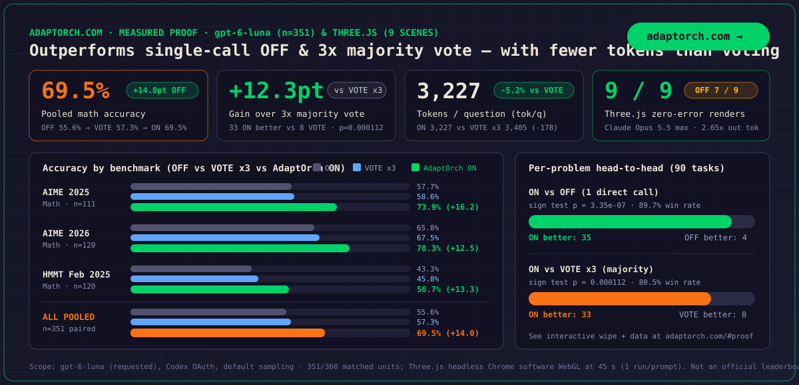</a>
</p>

<p align="center">
  <a href="https://adaptorch.com/#onoff-bench">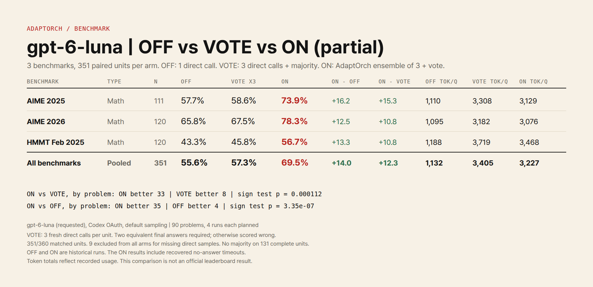</a>
</p>

| Benchmark | Type | n | OFF (1 call) | VOTE x3 (3 calls + majority) | AdaptOrch ON (ensemble of 3 + vote) | ON - OFF | ON - VOTE | OFF tok/Q | VOTE tok/Q | ON tok/Q |
| --- | --- | ---: | ---: | ---: | ---: | ---: | ---: | ---: | ---: | ---: |
| AIME 2025 | Math | 111 | 57.7% | 58.6% | **73.9%** | +16.2 pp | +15.3 pp | 1,110 | 3,308 | **3,129** |
| AIME 2026 | Math | 120 | 65.8% | 67.5% | **78.3%** | +12.5 pp | +10.8 pp | 1,095 | 3,182 | **3,076** |
| HMMT Feb 2025 | Math | 120 | 43.3% | 45.8% | **56.7%** | +13.3 pp | +10.8 pp | 1,188 | 3,719 | **3,468** |
| **All benchmarks (Pooled)** | **Pooled** | **351** | **55.6%** | **57.3%** | **69.5%** | **+14.0 pp** | **+12.3 pp** | **1,132** | **3,405** | **3,227** |

- **Per-problem wins (90 problems):** ON vs OFF — ON better **35**, OFF better **4** (`sign test p = 3.35e-07`, unit McNemar `p = 2.63e-09`). ON vs VOTE x3 — ON better **33**, VOTE better **8** (`sign test p = 0.000112`, unit McNemar `p = 8.91e-07`).
- **Wilson 95% CI (n = 351):** OFF `50.3%–60.7%`, VOTE x3 `52.0%–62.3%`, ON `64.5%–74.1%`. On all `n = 360` complete ON/OFF units, OFF is `55.8%` vs ON `69.7%` (`+13.9 pp`, McNemar `p = 1.55e-09`, `1,129` vs `3,221 tok/Q`).

> Scope (2026-11-23): `gpt-6-luna` (requested model ID, Codex OAuth, default sampling; provider did not attest the served model), 90 problems x 4 runs planned. `VOTE x3` runs 3 fresh direct calls per unit requiring 2 equivalent final answers (no majority on 131 complete units; 9/360 units excluded from all arms for missing direct samples). OFF and ON are historical runs; ON includes recovered no-answer timeouts with both attempts' tokens counted. Not an official leaderboard result.

### 2. Three.js WebGL scenes — OFF (1 direct call) vs AdaptOrch ON

Same prompt, same model (`Claude Opus 5.5` max effort), one run each. Across 9 interactive Three.js 3D scenes featured on **[adaptorch.com/#proof](https://adaptorch.com/#proof)**, AdaptOrch ON (`draft -> review -> final`, `sequential` routing + `robust` synthesis) achieved **9/9 zero-error WebGL renders** versus **7/9 for single-call OFF** at `2.65x` output tokens and `2.78x` call time.

> Try the interactive drag-wipe and side-by-side scene comparator live on **[adaptorch.com/#proof](https://adaptorch.com/#proof)** (or connect via MCP at **[adaptorch.com/mcp-docs](https://adaptorch.com/mcp-docs)**).

#### Visual OFF vs ON comparison (captured from [adaptorch.com/#proof](https://adaptorch.com/#proof))

<table>
  <thead>
    <tr>
      <th width="16%">Scene</th>
      <th width="42%">OFF — 1 direct call</th>
      <th width="42%">AdaptOrch ON — draft &#8594; review &#8594; final</th>
    </tr>
  </thead>
  <tbody>
    <tr>
      <td><strong>01. Voxel World</strong><br/><code>threejs-voxel-world</code><br/><em>Sky crash &#8594; Full world</em></td>
      <td>
        <a href="https://adaptorch.com/#proof">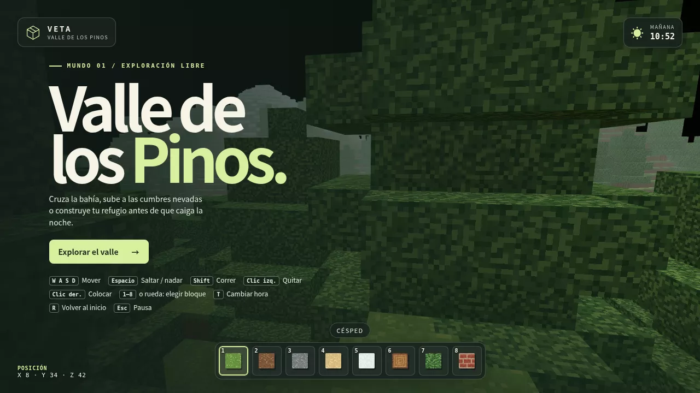</a><br/>
        <strong>1 WebGL error</strong> · 15,075 tok<br/>
        Sky shader failed to compile (<code>patch</code> is a GLSL reserved word); blocked spawn, no minimap.
      </td>
      <td>
        <a href="https://adaptorch.com/#proof">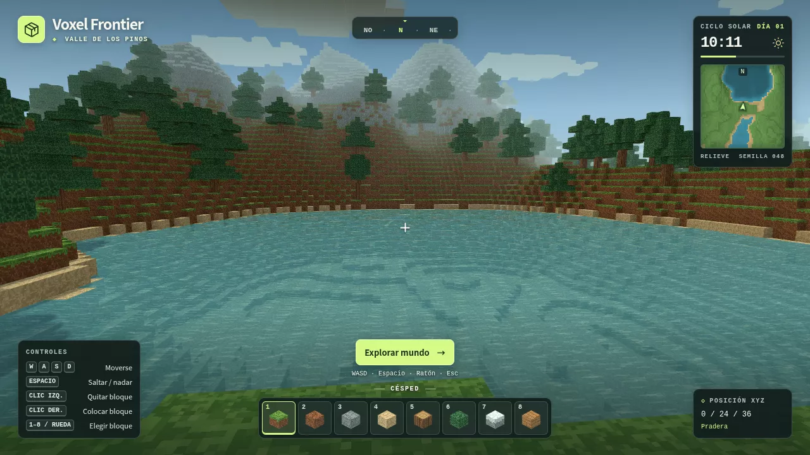</a><br/>
        <strong>0 browser errors</strong> · 52,376 tok<br/>
        Sky &amp; clouds compiled, solar cycle, sunlit lake, open terrain, compass and live minimap.
      </td>
    </tr>
    <tr>
      <td><strong>02. Black Hole</strong><br/><code>threejs-black-hole</code><br/><em>Basic disk &#8594; Doppler HUD</em></td>
      <td>
        <a href="https://adaptorch.com/#proof"></a><br/>
        <strong>0 errors</strong> · 14,190 tok<br/>
        Muted lensing, basic accretion ring with 3 minimal footer buttons; no speed slider or Doppler toggle.
      </td>
      <td>
        <a href="https://adaptorch.com/#proof">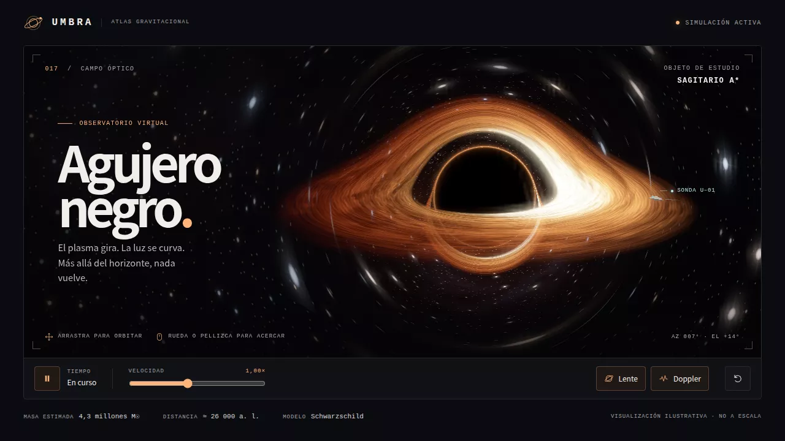</a><br/>
        <strong>0 errors · 7 review fixes</strong> · 44,587 tok<br/>
        Relativistic Doppler beaming, curved starfield, speed slider, telemetry console and Doppler toggle.
      </td>
    </tr>
    <tr>
      <td><strong>03. Medieval Village</strong><br/><code>threejs-medieval-village</code><br/><em>Flat pond &#8594; River &amp; bridge</em></td>
      <td>
        <a href="https://adaptorch.com/#proof">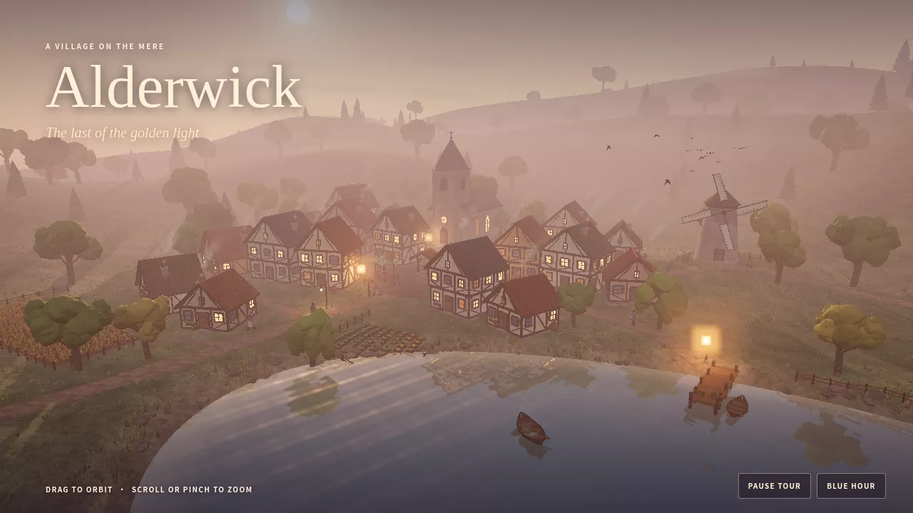</a><br/>
        <strong>0 errors</strong> · 30,354 tok<br/>
        Flat circular pond with hard clipped shoreline and overexposed lantern bloom.
      </td>
      <td>
        <a href="https://adaptorch.com/#proof">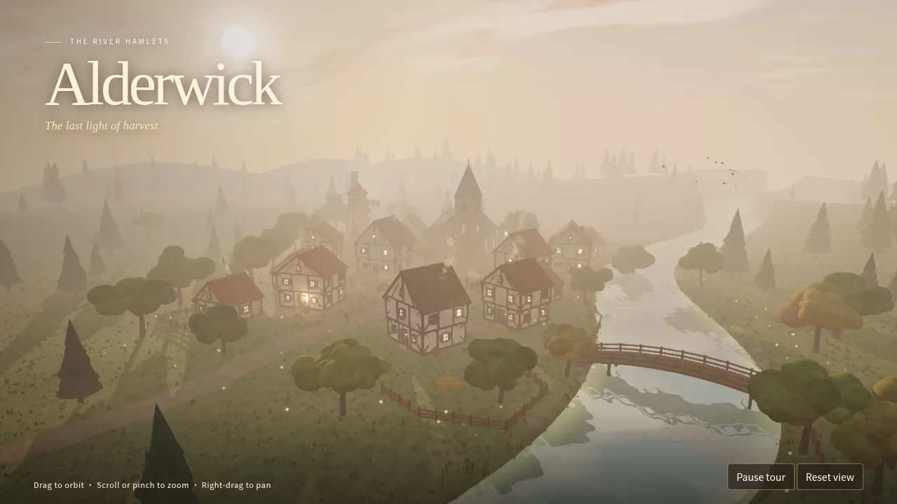</a><br/>
        <strong>0 errors · 9 review fixes</strong> · 71,396 tok<br/>
        Winding reflective river, wooden bridge, golden dusk mist, chimney smoke and fireflies.
      </td>
    </tr>
    <tr>
      <td><strong>04. Planet Scene</strong><br/><code>threejs-planet-scene</code><br/><em>OFF vs ON render</em></td>
      <td>
        <a href="https://adaptorch.com/#proof"></a><br/>
        <strong>0 errors</strong> · 14,015 tok (1 canvas)
      </td>
      <td>
        <a href="https://adaptorch.com/#proof">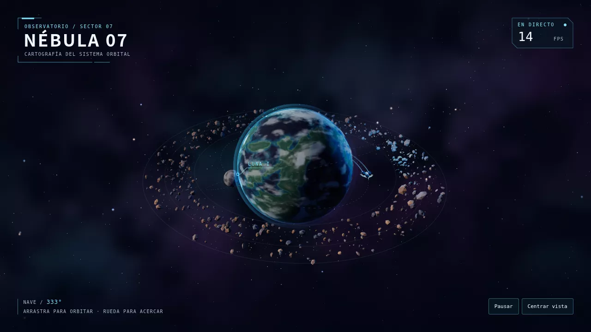</a><br/>
        <strong>0 errors</strong> · 34,678 tok (1 canvas)
      </td>
    </tr>
  </tbody>
</table>

| Metric | OFF (1 direct call) | AdaptOrch ON (`draft -> review -> final`) |
| --- | --- | --- |
| Zero-error browser renders | **7 / 9** | **9 / 9** |
| Model calls | 9 | 27 |
| Total output tokens | 135,557 | 359,102 (2.65x) |
| Total call wall time | 4,823 s | 13,409 s (2.78x) |

| Scene | OFF errors | ON errors | OFF out tok | ON out tok | Observed OFF vs ON outcome |
| --- | ---: | ---: | ---: | ---: | --- |
| `threejs-voxel-world` (landing featured) | **1** | **0** | 15,075 | 52,376 | OFF sky shader failed to compile (`patch` GLSL reserved word); ON rendered full sky, clouds, lake, compass, and terrain minimap |
| `threejs-black-hole` (landing featured) | 0 | 0 | 14,190 | 44,587 | OFF basic accretion ring with 3 minimal footer buttons; ON review caught 7 defects with stronger Doppler lensing and speed/Doppler HUD |
| `threejs-medieval-village` (landing featured) | 0 | 0 | 30,354 | 71,396 | OFF flat circular pond and clipped shoreline; ON review caught 9 defects with winding reflective river, bridge, and dusk mist |
| `threejs-rubik-cstech` | **2** | **0** | 10,860 | 30,055 | OFF returned a build script instead of HTML (`THREE is not defined`, 0 canvases); ON rendered valid interactive WebGL canvas |
| `threejs-rubik-iaen` | 0 | 0 | 16,279 | 41,565 | Both 0 errors (1 canvas); OFF still loading at 15 s, confirmed rendered at 60 s |
| `threejs-self-building-city` | 0 | 0 | 14,471 | 35,636 | Both 0 errors; OFF still loading at 15 s (confirmed rendered at 60 s); ON ready with 1 canvas |
| `threejs-planet-scene` | 0 | 0 | 14,015 | 34,678 | Both 0 errors (1 canvas) |
| `threejs-solar-system` | 0 | 0 | 6,534 | 19,188 | Both 0 errors (1 canvas) |
| `threejs-spiral-galaxy` | 0 | 0 | 13,779 | 29,621 | Both 0 errors (2 canvases) |

> Scope (2026-11-24): Local AdaptOrch engine (`run_task`, 3-node `draft -> review -> final`, `sequential` + `robust`, 0 reroutes, 9/9 `OK`); headless Chrome + SwiftShader software WebGL (screenshots at 45 s on [adaptorch.com/#proof](https://adaptorch.com/#proof), 15 s/60 s checks in source records), 1 run per prompt. Not a blind quality evaluation and not an official leaderboard result.

### 3. Synthetic paired ledger regression (directional, failed gates)

<p align="center">
  <a href="https://adaptorch.com">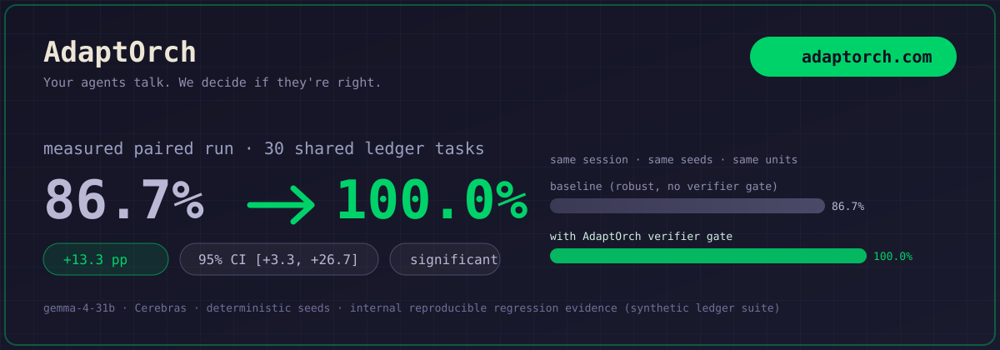</a>
</p>

Both arms see the **same 30 units, same seeds, same session** (gemma-4-31b on
Cerebras), so the paired delta cancels run-to-run drift:

| Arm | Accuracy |
| --- | --- |
| Baseline (robust, no verifier gate) | 86.7% |
| **With AdaptOrch verifier gate** | **100.0%** |

Paired delta **+13.3pp**, 95% CI **[+3.3, +26.7]** on this ledger family.
The aggregate verdict and predefined family gate **did not pass**. The public
[evidence JSON](https://adaptorch.com/data/adaptorch-benchmarks.json) records
`significant=false`, `aggregate_significant=false`, `gate_passed=false`, and
`official_claim_allowed=false`. Treat this as directional, not proven.

> Scope: internal reproducible regression evidence on a synthetic ledger
> suite (evidence experiment `paired_confirmatory_ledger`, full run IDs and
> reproduce commands shipped with the core repository). Not an official
> third-party benchmark.

Run your own workload through the hosted kernel at
**[adaptorch.com](https://adaptorch.com)** — Pro (`$39`/mo, 200 runs) and Team (`$149`/mo, 1,000 runs) include a 3-day free trial and annual billing discount. BYOK provider usage is billed separately;
confirm current limits in the [plan catalog](https://adaptorch.com/v1/plans).

## Scenario benchmark projection

<p align="center">
  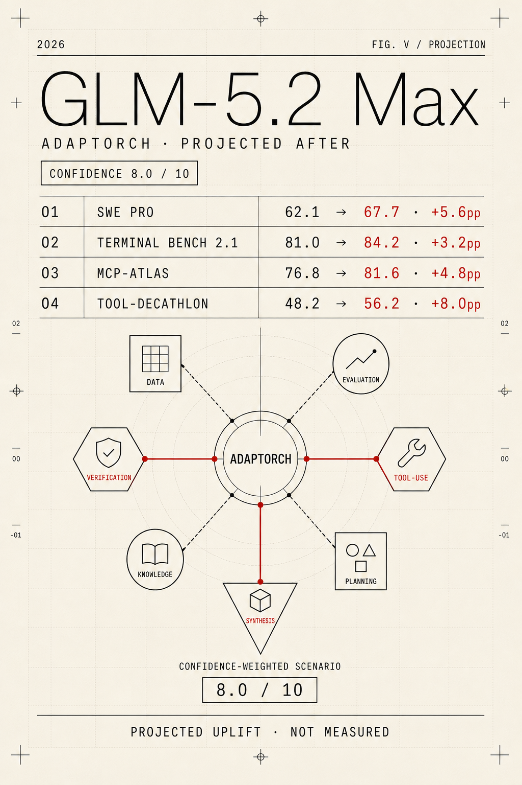
</p>

<p align="center"><sub>Confidence-weighted scenario projection (8.0/10). Projected uplift, not measured benchmark results.</sub></p>

## Architecture

<p align="center">
  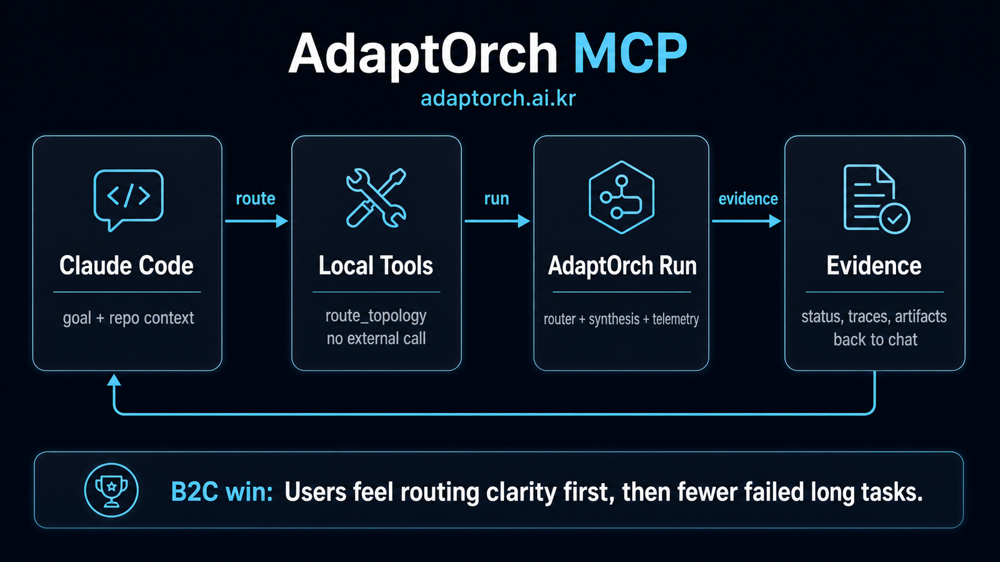
</p>

## Packages

| Path | Package | Purpose |
| --- | --- | --- |
| `packages/adaptorch-mcp` | `adaptorch-mcp` | Python CLI wrapper around `adaptorch.mcp_server` |

The wrapper intentionally delegates runtime behavior to `adaptorch.mcp_server`. That keeps MCP tools, resources, prompts, safety checks, and transports aligned with the latest AdaptOrch core release.

## Quickstart

### Local development

```bash
git clone git@github.com:dmae97/Adaptorch-MCP.git
git clone git@github.com:dmae97/adaptorch.git  # alongside Adaptorch-MCP
cd Adaptorch-MCP
uv sync --all-packages --extra dev
uv run adaptorch-mcp --help
```

`uv.lock` pins the engine to the published `adaptorch` git revision. To validate the
wrapper against a local engine checkout (algorithm-parity and MCP BYOK runs), install it over the pin:

```bash
make engine-local ENGINE_PATH=../adaptorch
make check
```

`packages/adaptorch-mcp/tests/test_engine_algorithm_parity.py` fails closed when the exposed
synthesis modes, deprecated aliases, topologies, or output extractors drift from the engine.

## stdio MCP

Use stdio for local clients such as Claude Code or desktop MCP hosts.

```bash
export ADAPTORCH_CONTROL_PLANE_TOKEN="<your-token>"
adaptorch-mcp --transport stdio --base-url https://adaptorch.com
```

Without the token, stdio still starts so registries can inspect it: `initialize`,
`ping` and `tools/list` come from a pinned catalog shipped in the package, and every
tool call fails with `-32001` before any network request. Listing tools proves only
that the server starts; it does not run anything. The root `Dockerfile` builds this
stdio server from a pinned commit; Glama uses the build spec in `docs/glama.md`.

### stdio over SSH

To run the wrapper on another machine, let SSH carry stdio. Keep the tokens in that
host's environment, not on the command line, and make sure the remote shell prints
nothing of its own:

```bash
claude mcp add adaptorch -- ssh -T build-host /opt/adaptorch/bin/adaptorch-mcp \
  --transport stdio --base-url https://adaptorch.com
```

- `-T` disables the pseudo-terminal, so no CR/LF translation or echo reaches the
  JSON-RPC stream. A login banner or an `echo` in a remote rc file corrupts it.
- SSH does not forward `ADAPTORCH_CONTROL_PLANE_TOKEN` by default. Set it on the
  remote host, or allow it explicitly with `SendEnv`/`AcceptEnv`.
- Check the path before configuring a client:
  `adaptorch-mcp-smoke --command "ssh -T build-host /opt/adaptorch/bin/adaptorch-mcp"`.
  The smoke reports non-JSON stdout as such and no longer stalls when the SSH
  session keeps stdout open after the answers arrive.
- When the session drops, the server sees EOF on stdin and exits; a run it already
  submitted keeps going on the control plane. Read it again with `resume_run_id`
  or `adaptorchctl run wait`, never by submitting again.

## HTTP MCP

Use HTTP for local gateways, reverse proxies, or remote MCP clients.

```bash
export ADAPTORCH_CONTROL_PLANE_TOKEN="<upstream-adaptorch-token>"
export ADAPTORCH_MCP_HTTP_AUTH_TOKEN="<client-facing-mcp-token>"

adaptorch-mcp \
  --transport http \
  --base-url https://adaptorch.com \
  --http-host 127.0.0.1 \
  --http-port 8765
```

Authenticated health check:

```bash
python - <<'PY'
import os
from urllib.request import Request, urlopen

request = Request(
    "http://127.0.0.1:8765/mcp/health",
    headers={"Authorization": f"Bearer {os.environ['ADAPTORCH_MCP_HTTP_AUTH_TOKEN']}"},
)
with urlopen(request) as response:
    print(response.read().decode("utf-8"))
PY
```

The listener binds loopback only and caps concurrent connections at
`ADAPTORCH_MCP_MAX_SSE_SUBSCRIBERS` (engine default 64) plus 64 for ordinary
requests; beyond that it answers 503 instead of queueing unbounded work. Shutdown
waits at most 10 seconds for open streams, and responses carry no `server` header.

## Network and transport notes

| Path | Transport | Behaviour |
| --- | --- | --- |
| SDK / `adaptorchctl` → control plane | HTTPS (TCP) | `GET`/`HEAD` reuse an idle keep-alive connection for up to 4 s while its socket shows no EOF. `POST`/`PUT` always open a fresh connection and are sent once. A read whose reused connection the peer had already closed is written once more on a new connection; a timeout is never re-sent. |
| Local MCP connector → control plane | HTTPS (TCP) | The same keep-alive handlers, so the engine's run polling no longer pays a TCP and TLS handshake per status read. |
| MCP client ↔ local wrapper | stdio, or stdio over SSH | Newline JSON-RPC; see [stdio over SSH](#stdio-over-ssh). |
| MCP client ↔ local wrapper | HTTP on loopback (TCP) | Bearer token, bounded concurrency, 10 s graceful shutdown. |

TLS uses the system trust store with certificate and hostname verification and
refuses anything older than TLS 1.2. Ambient `HTTP(S)_PROXY` variables and redirects
are still ignored; `SSL_CERT_FILE` still selects a private CA bundle. On Linux the
client acknowledges response segments immediately, so a server that leaves Nagle on
cannot stall a reused connection on the 40 ms delayed-ACK timer.

Measured on loopback HTTPS (100 sequential reads, this source revision): 4.1-5.6 ms
per read with a new connection per request, 0.4-0.6 ms with keep-alive. Across a real
network the saving per read is the TCP and TLS handshake round trips. Parsing a 3 MB,
5,000-run list page dropped from 268 ms to 129 ms. These are local micro-benchmarks,
not end-to-end claims.

There is no UDP transport: MCP defines stdio and Streamable HTTP, and every
AdaptOrch API is HTTP over TCP. HTTP/3 (QUIC) is not available in the standard
library this client is limited to.

## CLI and environment reference

| Command | Purpose | Important options |
| --- | --- | --- |
| `adaptorch-mcp` | Start the stdio or HTTP MCP server. | `--transport {stdio,http}`, `--base-url`, `--api-token`, `--timeout-seconds`, `--stdio-framing`, `--http-host`, `--http-port`, `--http-auth-token` |
| `adaptorch-mcp-doctor` | Print redacted local diagnostics. | `--json`, `--strict` |
| `adaptorch-mcp-smoke` | Verify stdio `initialize` + `tools/list`. | `--command`, `--base-url`, `--api-token`, `--timeout-seconds`, repeatable `--expected-tool` |

For `adaptorch-mcp`, the public wrapper resolves the control-plane URL in this
order: explicit `--base-url`, then trimmed/validated
`ADAPTORCH_CONTROL_PLANE_BASE_URL`, then the hosted fallback
`https://adaptorch.com`. `adaptorch-mcp-smoke` uses the same order and fallback
(before 0.6.1 it fell back to `http://127.0.0.1:8000`). Pass `--base-url`
explicitly in checked-in MCP client configs for reproducible behavior.

| Variable | Purpose | Notes |
| --- | --- | --- |
| `ADAPTORCH_CONTROL_PLANE_TOKEN` | Upstream AdaptOrch token. | Required unless `--api-token` is passed. |
| `ADAPTORCH_CONTROL_PLANE_BASE_URL` | Base URL used when `--base-url` is omitted. | Trimmed and validated as HTTP(S); do not embed credentials. |
| `ADAPTORCH_MCP_PROVIDER` | BYOK provider name, or `auto`. | Set with `ADAPTORCH_MCP_PROVIDER_MODEL`; forwarded only on run submission. `auto` uses the one provider whose own key variable is set (`OPENAI_API_KEY`, `ANTHROPIC_API_KEY`, `GROQ_API_KEY`, `OPENROUTER_API_KEY`, `GOOGLE_API_KEY`, `XAI_API_KEY`, `OPENCODE_GO_API_KEY`, `OPENAI_CODEX_API_KEY`, `WORKBUDDY_API_KEY`, `DEEPSEEK_API_KEY`, `COMMANDCODE_API_KEY`, `DEVIN_SESSION_TOKEN`) and fails closed otherwise. |
| `ADAPTORCH_MCP_PROVIDER_MODEL` | BYOK provider model. | Set with `ADAPTORCH_MCP_PROVIDER`; forwarded only on run submission. |
| `ADAPTORCH_MCP_PROVIDER_API_KEY` | BYOK provider secret or OAuth access token. | Process-local, omitted from tool schemas/bodies and non-run requests; optional only for keyless providers. |
| `ADAPTORCH_MCP_PROVIDER_API_KEY_COMMAND` | Caller-owned rotating token helper. | Mutually exclusive with the static key; invoked once per submission, never for polling or error redaction. |
| `ADAPTORCH_MCP_PROVIDER_AUTH_TYPE` | `api_key` or `oauth`. | OAuth currently supports explicit `openai_codex`; not a browser login or refresh-token service. |
| `ADAPTORCH_MCP_PROVIDER_ACCOUNT_ID` | Request-scoped OAuth account ID. | Validated, hidden from repr/errors, forwarded only on submission; never borrows the server's account. |
| `ADAPTORCH_MCP_HTTP_AUTH_TOKEN` | Client-facing bearer token for HTTP/SSE MCP. | Keep separate from the upstream control-plane token. |
| `ADAPTORCH_MCP_ALLOWED_ORIGINS` | Comma-separated HTTP origin allowlist. | Use with browser or remote HTTP clients. |
| `ADAPTORCH_MCP_MAX_PAYLOAD_SIZE_BYTES` | Maximum accepted HTTP request body size. | Keep bounded for public deployments. |
| `ADAPTORCH_MCP_REQUEST_TIMEOUT_SECONDS` | HTTP request timeout budget. | Applies to HTTP server request handling. |
| `ADAPTORCH_MCP_MAX_SSE_SUBSCRIBERS` | Maximum concurrent SSE subscribers. | Defaults are provided by `adaptorch.mcp_server`. |
| `ADAPTORCH_MCP_TIMEOUT_SECONDS` | Control-plane client timeout for app-factory usage. | Useful when embedding the ASGI app. |
| `ADAPTORCH_REPRODUCIBLE` | Benchmark/eval reproducibility beta. | Benchmark/eval scope only; not general runtime determinism. |
| `ADAPTORCH_ROUTER_ACCURACY_GATE` | Online-router learned-model gate. | `point` default or `wilson`; advanced/operator use. |
| `ADAPTORCH_PAPER_SEMANTIC_WEIGHT` | Paper-mode lexical/semantic blend. | Default `0.35`; nonzero values use Python scoring over the native fast path. |

## Claude Code MCP config

```json
{
  "mcpServers": {
    "adaptorch": {
      "command": "adaptorch-mcp",
      "args": [
        "--transport",
        "stdio",
        "--base-url",
        "https://adaptorch.com"
      ],
      "env": {
        "ADAPTORCH_CONTROL_PLANE_TOKEN": "${ADAPTORCH_CONTROL_PLANE_TOKEN}"
      }
    }
  }
}
```

More templates:

- `examples/claude_desktop_config.json`
- `examples/omk.mcp.json`
- `examples/mcp-http.env.example`

Checked-in examples use placeholders or environment interpolation. Fill real
URLs and tokens only in local, uncommitted config files.

## Diagnostics

Runs may include `verification_diagnostics` with version marker
`verification_diagnostics_schema_version: "verification.diagnostics/v1"`.
These bounded observations do not change the result. `project_report` is an
untrusted project claim; `process_spawn` is a verifier launch observation.
Only closed codes, scope and the four PDF tool names are exposed; logs remain private.
Malformed optional metadata is omitted without losing the run. See [tools](docs/tools.md).

Print redacted local diagnostics:

```bash
adaptorch-mcp-doctor
adaptorch-mcp-doctor --json
adaptorch-mcp-doctor --strict
```

Run a stdio smoke test. The token is passed through the child environment, not process arguments. If no base URL is supplied, smoke targets `https://adaptorch.com`; pass `--base-url http://127.0.0.1:8000` for a local control plane. The default timeout is 30 seconds.

```bash
export ADAPTORCH_CONTROL_PLANE_TOKEN="<your-token>"
adaptorch-mcp-smoke --base-url https://adaptorch.com
```

Expected JSON includes `"ok": true`, `adaptorch_plan_catalog`, and the expected
core tool subset. Doctor JSON also includes redacted `controlPlane` metadata for
the resolved base-url source. Add repeatable `--expected-tool <name>` flags when
validating a specific hosted/core release.

## Tool surface

| Tool | Purpose |
| --- | --- |
| `adaptorch_run` | Submit an AdaptOrch task payload and optionally wait. |
| `adaptorch_get_run` | Read a run summary, optional bounded Correctness Wall view, and optional `run-output.v1` / `run-generation.v1` output (`include_output=true`) by `run_id`. |
| `adaptorch_get_artifacts` | Read artifact metadata for a run. |
| `adaptorch_list_runs` | List recent runs. |
| `adaptorch_get_traces` | Read execution traces (`full` profile only). |
| `adaptorch_cancel_run` | Request run cancellation (write/destructive; keep manually approved). |
| `adaptorch_route_topology` | Route a DAG through AdaptOrch's topology router and price the routed topology against the baseline (authenticated hosted advice in thin remote; local oracle in `full` profile only). |
| `adaptorch_recheck_claim` | Opt-in BYOK claim recheck against only the supplied quotes when advertised by the authenticated control plane. |
| `adaptorch_server_metrics` | Read redacted MCP server metrics. |
| `adaptorch_capabilities` | Read synthesis modes, topologies, extractors, verifier/VERA vocabularies, connectors, server features, and plan catalog. |
| `adaptorch_usage` | Read the calling tenant's usage window (plan level, period, used, limit, remaining, percentage). |
| `adaptorch_plan_catalog` | Read hosted plan catalog (Pro `$39`/mo, Team `$149`/mo; 3-day free trial, annual discount). |

The default `remote` profile exposes the nine tools other than `adaptorch_get_traces` and `adaptorch_route_topology`. The engine's read-only `adaptorch_navigate_evidence` (fixed evidence-pack navigation, `algorithm_version` defaulting to `graph_v5`) is likewise `full`-profile only. `adaptorch_get_run` publishes a closed `outputSchema` and safe `structuredContent`; its optional `correctness_wall` is advisory observability, not a correctness proof, selector decision, or apply authorization.

For trusted local clients, auto-approve only tools whose outputs are safe for
that client. Keep `adaptorch_run` and `adaptorch_cancel_run` manually approved.
For shared or production clients, avoid auto-approving run, artifact, and trace
readers unless those payloads are already sanitized.

## GitHub Action

Run a task from a trusted workflow with the [GitHub Action](docs/github-action.md).
The [Marketplace preview](https://github.com/marketplace/actions/adaptorch-run-and-evidence)
uses a separate repository containing only the remote Action and public API client;
no private engine is installed on the runner. It reports execution and verification
separately and can optionally save a JSON run report. API credentials belong in
GitHub Secrets. Its tests use a loopback fixture and do not incur model charges;
compatibility with a hosted deployment still needs a real run.

## Branding assets

- GitHub hero: `assets/readme-hero.png`
- GitHub flow diagram: `assets/mcp-flow.png`
- GPT-image-2.0 raster prompt brief: `docs/brand/gpt-image-2-brief.md`

## Public release checklist

**The current local MCP wrapper is blocked by the public-wheel gate because it
depends on the private engine.** Build/test success and a publish dry-run are not
permission to publish that wheel. The engine-free SDK/CLI have separate wheel gates.

For local validation only:

```bash
uv run ruff check packages/adaptorch-mcp
uv run mypy packages/adaptorch-mcp/src
uv run pytest packages/adaptorch-mcp/tests -q
uv run python -m build packages/adaptorch-mcp --outdir dist
```

Publishing requires an independently passing public-wheel gate and explicit release
approval. Only then follow `docs/publishing.md` for the applicable public package.

## Security

Never commit `.env`, API keys, bearer tokens, private keys, or MCP client tokens. See `SECURITY.md`.


## Frequently asked questions

### What is AdaptOrch MCP?

AdaptOrch MCP (`adaptorch-mcp`) is a remote-only Python Model Context Protocol (MCP) server that connects AI coding clients (Claude Code, Cursor, Codex, Gemini CLI, Windsurf, Kimi Code, Grok) to the hosted AdaptOrch control plane for DAG topology routing, multi-model synthesis, and verifiable execution receipts.

### Does `adaptorch-mcp` install or run the private AdaptOrch engine locally?

No. Since version `0.6.0`, `adaptorch-mcp` depends only on the standard-library `adaptorch-client` SDK and forwards validated JSON-RPC calls to `POST /v1/mcp` over HTTPS without bundling or importing private engine code.

### How does `include_output=true` distinguish token-limit truncation from display clipping?

`adaptorch_get_run(..., include_output=True)` returns `run-output.v1` with a separate `generation` block (`run-generation.v1`: `limit_observed`, `stop_observed`, or `unknown`) alongside per-subtask `display_truncated` and `returned_bytes`, so 64 KiB display clipping is never confused with provider `length`/`max_tokens` stops.

### How are BYOK provider credentials handled?

Provider keys are kept in the local MCP process environment, omitted from MCP tool schemas and JSON request bodies, redacted from errors, and forwarded only as run-submission headers on billable `adaptorch_run` and `adaptorch_recheck_claim` calls.

## Support and issues

Report bugs, integration questions, or MCP client compatibility notes in [GitHub Issues](https://github.com/dmae97/Adaptorch-MCP/issues), check [adaptorch.com/mcp-docs](https://adaptorch.com/mcp-docs), or run `adaptorch-mcp-doctor --json` to generate redacted diagnostics before filing a ticket.

## License

Proprietary — Copyright ClassicMate. All rights reserved. See `LICENSE`.
